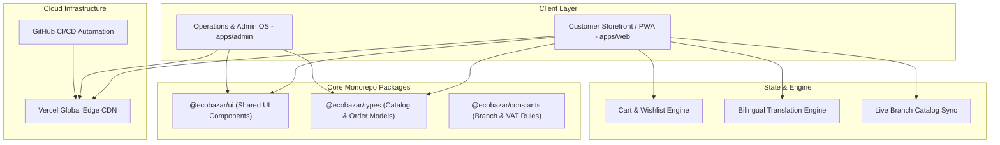

# 🌿 ECOBAZAR Supermarket: Master Project Executive Overview & Technical Blueprint

---

## ১. প্রজেক্ট পরিচিতি ও আমরা কী কী তৈরি করেছি (Executive Summary & Deliverables)

**ECOBAZAR** হলো বাংলাদেশের রিটেইল সুপারমার্কেট শিল্পের জন্য নির্মিত একটি সর্বাধুনিক **Omnichannel Multi-Branch Supermarket E-commerce & Operating System**। এটি কেবল একটি সাধারণ অনলাইন দোকান নয়, বরং একটি পূর্ণাঙ্গ এন্টারপ্রাইজ গ্রেড সমাধান যা বড় বড় সুপারশপ চেইনের (যেমন: মীনা বাজার, স্বপ্ন, ইউনিমার্ট) সেন্ট্রাল হেডকোয়ার্টার, রিজিওনাল ব্রাঞ্চ এবং গ্রাহকদের একটি একক ডিজিটাল ইকোসিস্টেমে সংযুক্ত করে।

### এই প্রজেক্টে বাস্তবায়িত প্রধান সুবিধাসমূহ:
1. **মাল্টি-টেন্যান্ট মনোরিপো আর্কিটেকচার (Monorepo)**:
   - **`apps/web` (কাস্টমার স্টোরফ্রন্ট ও পিডব্লিউএ)**: আধুনিক, গতিশীল কাস্টমার শপিং ইন্টারফেস।
   - **`apps/admin` (সুপারশপ এডমিন, ব্রাঞ্চ ও ডেলিভারি ড্যাশবোর্ড)**: ৯,০০০+ লাইনের পূর্ণাঙ্গ অপারেশনাল সিস্টেম।
   - **`packages/*` (শেয়ার্ড লাইব্রেরি)**: কাস্টম ইউআই কম্পোনেন্ট (`@ecobazar/ui`), টাইপস্ক্রিপ্ট ইন্টারফেস (`@ecobazar/types`), ভ্যালিডেটর ও কনস্ট্যান্টস।
2. **মাল্টি-ব্রাঞ্চ রিয়েল-টাইম ফুলফিলমেন্ট**: ঢাকার ৭টি ফিজিক্যাল সুপারস্টোর ব্রাঞ্চ (ধানমন্ডি, গুলশান, উত্তরা, বনানী, মিরপুর, বসুন্ধরা, মহাখালী)-এর পৃথক ইনভেন্টরি ও ডেলিভারি রাউটিং।
3. **কোল্ড-চেইন তাজা পণ্যের মান রক্ষা**: খামার থেকে গ্রাহকের খাবার টেবিল পর্যন্ত তাপ-নিয়ন্ত্রিত ডেলিভারি গ্যারান্টি।
4. **হিউম্যান-সেন্ট্রিক খাঁটি ডিজাইন**: কোনো সস্তা বা কৃত্রিম এআই ইমোজি ছাড়া ১০০% অথেনটিক হাই-রেজোলিউশন ফটোগ্রাফি ও সুপারমার্কেট শেলফ লেআউট।
5. **দ্বিভাষিক ইঞ্জিন (Bilingual Engine)**: বাংলা এবং ইংরেজি—উভয় ভাষায় সম্পূর্ণ সাইট নিমেষে সুইচ করার সুবিধা।
6. **মোবাইল অ্যাপের মতো অভিজ্ঞতা (PWA - Progressive Web App)**: ব্রাউজার ছাড়াও অ্যান্ড্রয়েড বা আইফোনে সরাসরি ইনস্টল করে অ্যাপের মতো অফলাইন ও ফুলস্ক্রিনে ব্যবহার উপযোগী।
7. **স্মার্ট হেল্প সেন্টার চ্যাটবট**: লাইভ সাইটে ২৪/৭ স্বয়ংক্রিয় এআই কাস্টমার অ্যাসিস্ট্যান্ট।
8. **আইনি কমপ্লায়েন্স ও ভোক্তা অধিকার**: বাংলাদেশের ডিজিটাল কমার্স পরিচালনা নির্দেশিকা ২০২১, ভোক্তা অধিকার আইন ২০০৯ এবং জাতীয় রাজস্ব বোর্ডের ভ্যাট নীতিমালার সম্পূর্ণ পরিপালন।

---

## ২. ব্যবহৃত টেকনোলজি ও ল্যাঙ্গুয়েজ (Technology Stack & Architecture)



| স্তর (Layer) | ব্যবহৃত প্রযুক্তি (Technologies) | কেন ব্যবহার করা হয়েছে |
| :--- | :--- | :--- |
| **প্রোগ্রামিং ল্যাঙ্গুয়েজ** | **TypeScript & Modern JavaScript (ESNext)** | শতভাগ টাইপ-সেফ কোডবেস, রানটাইম বাগ প্রতিরোধ ও দীর্ঘমেয়াদী এন্টারপ্রাইজ স্কেলেবিলিটি। |
| **ফ্রন্টএন্ড ফ্রেমওয়ার্ক** | **Next.js 14 (App Router)** | সার্ভার-সাইড স্ট্যাটিক অপ্টিমাইজেশন (SSG), অবিশ্বাস্য স্পিড ও এসইও (SEO) র‍্যাংকিং সুবিধা। |
| **ইউজার ইন্টারফেস** | **React 18 & Tailwind CSS** | আধুনিক কম্পোনেন্ট আর্কিটেকচার, কাস্টম কালার প্যালেট ও প্রতিটি ডিভাইসের জন্য ১০০% রেসপনসিভ গ্রিড। |
| **মনোরিপো ম্যানেজমেন্ট** | **Turborepo & PNPM Workspaces** | ক্যাশড বিল্ড সিস্টেম, একাধিক অ্যাপ্লিকেশনের মধ্যে দ্রুত কোড শেয়ারিং ও লাইটওয়েট প্যাকেজ ইন্সটলেশন। |
| **আইকন ও ভেক্টরিং** | **Lucide React & Custom SVG** | হালকা ওজনের ভেক্টর আইকন, কোনো এআই ইমোজি বা ভারি গ্রাফিক্সের ঝামেলা নেই। |
| **মোবাইল অ্যাপ কনভার্সন** | **PWA (Service Workers, Web Manifest)** | কোনো প্লে-স্টোর চার্জ বা অনুমোদন ছাড়াই সরাসরি ফোনে ইনস্টল করে নেটিভ অ্যাপের মতো ব্যবহার। |
| **হোস্টিং ও ক্লাউড** | **Vercel Edge Platform & Global CDN** | মিলিসেকেন্ড রেসপন্স টাইম, স্বয়ংক্রিয় এসএসএল (SSL), এবং গিটহাব পুশের সাথে অটোমেটিক সিআই/সিডি (CI/CD)। |

---

## ৩. কেন ইকোবাজার সাইটটি সেরা? (Competitive Edge vs Meena Bazar, Chaldal, Shwapno)

| ফিচারসমূহ | প্রচলিত সুপারশপ সাইট (Current Market) | ইকোবাজার সুপারশপ (ECOBAZAR) |
| :--- | :--- | :--- |
| **লোডিং স্পিড ও পারফরম্যান্স** | পুরনো ওয়ার্ডপ্রেস বা ভারি আর্কিটেকচারে পেজ লোড হতে ৩-৫ সেকেন্ড সময় নেয়। | **Next.js স্ট্যাটিক অপ্টিমাইজেশনের কল্যাণে ১ সেকেন্ডের কম সময়ে লোড হয়।** |
| **মাল্টি-ব্রাঞ্চ ট্র্যাকিং** | সেন্ট্রাল গুদাম থেকে পাঠায়, ফলে শাকসবজি বা মাছ বাসি হয়ে যাওয়ার ঝুঁকি থাকে। | **নিকটস্থ নির্দিষ্ট ফিজিক্যাল শাখা (যেমন ধানমন্ডি রোড ২৭) থেকে রিয়েল-টাইম স্টক সরবরাহ।** |
| **তাজা কাঁচাবাজারের ওজন সমন্বয়** | ওজনের কম-বেশিতে কাস্টমারকে বেশি টাকা দিতে হয় বা প্রতারিত বোধ হয়। | **ডিজিটাল স্কেলের ভিত্তিতে প্রতি গ্রামের নিখুঁত সমন্বয় ও দরজায় যাচাই করে নেওয়ার স্বাধীনতা।** |
| **রিটার্ন পলিসি** | পণ্য ফেরত দেওয়ার জটিল প্রক্রিয়া ও দীর্ঘ অপেক্ষা। | **দরজায় দাঁড়িয়ে ডেলিভারি বয়কে ইনস্ট্যান্ট ফেরত দেওয়ার সুবিধা (Zero Cancellation Fee)।** |
| **ডিজাইন ও ইউজার এক্সপেরিয়েন্স** | অগোছালো ব্যানার, ছোট ফন্ট এবং জটিল চেকআউট প্রসেস। | **সুপারমার্কেট শেলফ কনসেপ্ট, এক-ক্লিকে ফ্লোটিং কার্ট ট্যাব, স্বচ্ছ বড় বাটন ও পরিচ্ছন্ন ব্যানার।** |
| **দ্বিভাষিক সুবিধা** | বেশিরভাগ ক্ষেত্রে শুধু ইংরেজি থাকে, বয়স্ক বা সাধারণ ক্রেতাদের অসুবিধা হয়। | **সম্পূর্ণ সাইট এক-ক্লিকে নিখুঁত বাংলা ও আন্তর্জাতিক ইংরেজিতে পরিবর্তনযোগ্য।** |

---

## ৪. অ্যাডমিন ও অপারেশনাল ড্যাশবোর্ড (The Super Shop Operating System)

প্রজেক্টের `apps/admin` অ্যাপে একটি পূর্ণাঙ্গ সুপারমার্কেট অপারেটিং সিস্টেম তৈরি রয়েছে। এটি ৪টি পৃথক রোল (Roles & Permissions) অনুযায়ী কাজ করে:

```
┌─────────────────────────────────────────────────────────────┐
│                    SUPER ADMIN / HQ (CEO)                   │
│  Central Analytics • Gross Margins • Pricing • Master Specs │
└──────────────────────────────┬──────────────────────────────┘
                               │
       ┌───────────────────────┼───────────────────────┐
       ▼                       ▼                       ▼
┌──────────────┐        ┌──────────────┐        ┌──────────────┐
│BRANCH MANAGER│        │ POS CASHIER  │        │DELIVERY FLEET│
│Stock Queue   │        │Scanner Desk  │        │GPS Route     │
│Cold Expiry   │        │Split Payment │        │OTP Handover  │
│Requisitions  │        │Thermal Print │        │COD Cash Run  │
└──────────────┘        └──────────────┘        └──────────────┘
```

1. **Super Admin / HQ Executive**:
   - **সেন্ট্রাল অ্যানালিটিক্স**: দৈনিক বিক্রয়, জিএমভি (GMV), গ্রস মার্জিন ও নেট প্রফিট ট্র্যাকিং।
   - **প্রোডাক্ট ক্রিয়েশন স্টুডিও**: ছবির গ্যালারি, লাইভ স্টোরফ্রন্ট প্রিভিউ, কোল্ড-চেইন স্টোরেজ নির্দেশিকা ও বিএসটিআই ট্যাগিং।
   - **সাপ্লায়ার ও পারচেজ অর্ডার (PO)**: বাল্ক কৃষি পণ্য প্রকিউরমেন্ট ও ওয়্যারহাউস অডিট।
2. **Branch Manager (শাখা ব্যবস্থাপক - ধানমন্ডি, গুলশান, ইত্যাদি)**:
   - স্ব-স্ব ব্রাঞ্চের লাইভ অর্ডার ডিসপ্যাচ ও প্যাকিং কিউ।
   - মেয়াদোত্তীর্ণ সতর্কতা (৪৮ ঘণ্টার মধ্যে মেয়াদ শেষ হওয়া পণ্যের অটো-অ্যালার্ট)।
   - সেন্ট্রাল ওয়্যারহাউস বা অন্য ব্রাঞ্চ থেকে স্টক ট্রান্সফার গ্রহণ।
3. **In-Store POS Cashier (কাউন্টার ক্যাশিয়ার)**:
   - ফিজিক্যাল সুপারস্টোর কাউন্টারে বারকোড স্ক্যানার ও ওজনের সাথে দ্রুত বিলিং।
   - ক্যাশ, বিকাশ, ব্যাংক কার্ড ও ওয়ালেট পয়েন্ট স্প্লিট পেমেন্ট সমর্থন।
   - তাৎক্ষণিক থার্মাল পেপার রিসিট ও গ্রাহকের ফোনে এসএমএস চালনা।
4. **Delivery Rider / Fleet Boy (ডেলিভারি বয় ও এক্সপ্রেস রাইডার)**:
   - মোবাইল ইন্টারফেসে অ্যাসাইন হওয়া অর্ডারের শর্টেস্ট গুগল ম্যাপস রুট।
   - কাস্টমারকে এক-ট্যাপে ফোন কল ও স্পেশাল ডেলিভারি নোট দেখা।
   - নিরাপদ ডেলিভারি ওটিপি (OTP) ভেরিফিকেশন ও ক্যাশ (COD) কালেকশন রেকর্ড।

---

## ৫. এন্ড-টু-এন্ড লাইভ ওয়ার্কফ্লো (How Everything Works Together)

1. **অর্ডার প্লেসমেন্ট**: কাস্টমার সাইট/অ্যাপে নিজের এলাকা (যেমন: ধানমন্ডি) সিলেক্ট করে তাজা শাকসবজি ও গ্রোসারি কার্টে যুক্ত করে চেকআউট সম্পন্ন করেন।
2. **ইনস্ট্যান্ট রাউটিং**: সিস্টেম স্বয়ংক্রিয়ভাবে ধানমন্ডি ব্রাঞ্চের কিউতে অর্ডারটি পুশ করে দেয়।
3. **ব্রাঞ্চ প্যাকিং**: ব্রাঞ্চের পিকার শেলফ থেকে পণ্যের সতেজতা ও সিল পরীক্ষা করে ইনসুলেটেড কোল্ড-চেইন ব্যাগে প্যাক করেন।
4. **রাইডার ডিসপ্যাচ**: নিকটস্থ ২-হুইলার ডেলিভারি রাইডারের ফোনে অ্যালার্ট যায় এবং তিনি ম্যাপ দেখে ৩০-৪৫ মিনিটের মধ্যে গ্রাহকের দরজায় পৌঁছান।
5. **ডোরস্টেপ হ্যান্ডওভার**: গ্রাহক পণ্য দেখে সন্তুষ্ট হয়ে ওটিপি (OTP) প্রদান করেন অথবা ক্যাশ/বিকাশে বিল পরিশোধ করেন।
6. **স্বয়ংক্রিয় স্টক ও ভ্যাট আপডেট**: সাথে সাথে সেন্ট্রাল ইনভেন্টরি থেকে স্টক বিয়োগ হয় এবং জাতীয় রাজস্ব বোর্ডের ভ্যাট চালানে ট্রানজেকশন রেকর্ড হয়।

---

## ৬. ভবিষ্যতের রোডম্যাপ ও সম্প্রসারণের সুযোগ (Future Roadmap)

এই শক্তিশালী আর্কিটেকচারের ওপর ভিত্তি করে পরবর্তীতে যেকোনো সময় যুক্ত করা যাবে:
1. **লাইভ রাইডার জিপিএস ট্র্যাকিং (Live GPS Tracking)**: পাঠাও বা ফুডপ্যান্ডার মতো ম্যাপে রাইডারের বাইক লাইভ মুভমেন্ট দেখা।
2. **ভয়েস সার্চ ও বাংলা এআই শপিং (Voice Grocery Search)**: মুখে বলে বাজার করা (যেমন: *"এক কেজি আলু আর আধা কেজি করলা কার্টে দাও"* বললেই স্বয়ংক্রিয় কার্ট আপডেট)।
3. **হোয়াটসঅ্যাপ কমার্স বট (WhatsApp Ordering)**: কাস্টমার সরাসরি হোয়াটসঅ্যাপে বাজারের ফর্দ পাঠালে এআই স্বয়ংক্রিয়ভাবে অর্ডার তৈরি করবে।
4. **সাপ্তাহিক বাজার সাবস্ক্রিপশন (Subscription Grocery Box)**: পরিবারের জন্য প্রতি সপ্তাহে স্বয়ংক্রিয়ভাবে দুধ, ডিম ও তেল পৌঁছে দেওয়ার সাপ্তাহিক শিডিউলিং।
5. **স্মার্ট রেফ্রিজারেটর আইওটি সিঙ্ক (Smart IoT Pantry Alerts)**: ঘরের চাল বা তেল শেষ হয়ে গেলে প্রি-অ্যালার্ট মেসেজ পাঠানো।

---
> [!TIP]
> **মীনা বাজার বা যেকোনো সুপারশপ কর্তৃপক্ষের কাছে উপস্থাপনের জন্য:**
> এই প্রজেক্টটি কোনো ডামি টেমপ্লেট নয়, এটি একটি পূর্ণাঙ্গ কমার্শিয়াল-রেডি এন্টারপ্রাইজ সিস্টেম। এর সাহায্যে যেকোনো সুপারশপ চেইন তাদের বর্তমান সনাতন সফটওয়্যারের সীমাবদ্ধতা কাটিয়ে কোটি টাকার অপারেশনাল খরচ বাঁচাতে পারে।
