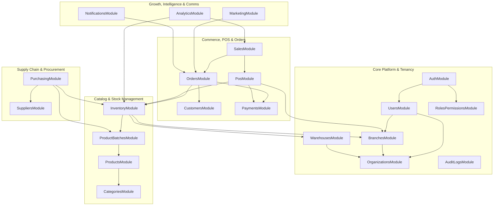

# ECOBAZAR — Backend Architecture Specification

## 1. Architectural Philosophy

The ECOBAZAR backend (`apps/api`) is structured as a **Modular Monolith** using **NestJS**, **Prisma ORM**, **PostgreSQL**, and **Redis/BullMQ**. 

### Why a Modular Monolith?
1. **Single Deployment Unit, Strict Logical Boundaries**: Every business domain is encapsulated in an isolated NestJS module with explicit public service contracts and data transfer objects (DTOs).
2. **ACID Transaction Guarantees**: Omnichannel retail requires atomic operations across inventory batch allocation, cash drawer balance, order generation, and payment ledgers. A monolithic database allows PostgreSQL interactive transactions without complex distributed two-phase commits.
3. **Low Latency & Operational Simplicity**: Eliminates network serialization and inter-service failure modes, which is essential for high-throughput in-store POS checkouts.
4. **Microservices Ready**: If a specific module (e.g. `NotificationsModule` or `AnalyticsModule`) demands independent horizontal scaling later, its decoupled architecture allows straightforward extraction.

---

## 2. NestJS Request Lifecycle & Cross-Cutting Concerns

Every incoming request passes through a standardized execution pipeline:

```
[ Client Request ]
       │
       ▼
1. Global Middleware (Helmet, CORS, Request Logger, AsyncLocalStorage Context)
       │
       ▼
2. Global Guards (JwtAuthGuard -> RbacGuard -> BranchScopeGuard)
       │
       ▼
3. Global Interceptors (Pre-Controller: Transaction TraceId, Metrics Timer)
       │
       ▼
4. Global Pipes (ZodValidationPipe - Request Sanitization & Type Coercion)
       │
       ▼
5. Controller (Route Handler - Extracts DTO and Authenticated Context)
       │
       ▼
6. Domain Service (Business Logic, FEFO Selection, ACID Transactions)
       │
       ▼
7. Data Access Layer (Prisma Client with Row-Level Isolation Extensions)
       │
       ▼
8. Global Interceptors (Post-Controller: Response Envelope Serialization)
       │
       ▼
9. Exception Filters (Catches Domain/System Errors -> Formats Standard Error JSON)
       │
       ▼
[ Client Response ]
```

---

## 3. Comprehensive Breakdown of the 21 Core Modules



---

### Module 1: `AuthModule`
- **Responsibility**: User authentication, password reset, token issuance, refresh token rotation, and phone OTP verification.
- **Key Services**: `AuthService`, `TokenService`, `OtpService`, `PasswordService`.
- **Dependencies**: `UsersModule`, `NotificationsModule`, `AuditLogsModule`.
- **Events Emitted**: `auth.login.success`, `auth.login.failed`, `auth.password_reset`.

### Module 2: `UsersModule`
- **Responsibility**: System user profiles, employee onboarding, branch assignments, and status management (active/suspended).
- **Key Services**: `UsersService`, `UserProfilesService`.
- **Dependencies**: `OrganizationsModule`, `BranchesModule`, `RolesPermissionsModule`.
- **Events Emitted**: `user.created`, `user.branch_assigned`, `user.deactivated`.

### Module 3: `OrganizationsModule`
- **Responsibility**: Master tenant management, organization-level settings, legal details, and base currency/timezone configuration.
- **Key Services**: `OrganizationsService`, `OrganizationSettingsService`.
- **Dependencies**: None (Root of the tenancy hierarchy).
- **Events Emitted**: `organization.updated`.

### Module 4: `BranchesModule`
- **Responsibility**: Physical store management, opening hours, geographic coordinates (lat/lng), delivery radius, and branch configuration.
- **Key Services**: `BranchesService`, `BranchConfigService`.
- **Dependencies**: `OrganizationsModule`.
- **Events Emitted**: `branch.created`, `branch.status_changed`.

### Module 5: `WarehousesModule`
- **Responsibility**: Central and regional fulfillment centers, storage zones, aisle/shelf/bin hierarchies, and bulk dispatch handling.
- **Key Services**: `WarehousesService`, `WarehouseBinsService`.
- **Dependencies**: `OrganizationsModule`.
- **Events Emitted**: `warehouse.created`, `warehouse.capacity_alert`.

### Module 6: `RolesPermissionsModule`
- **Responsibility**: Granular RBAC definitions, custom permission groups, and role-to-permission mapping.
- **Key Services**: `RolesPermissionsService`, `PermissionGuard`.
- **Dependencies**: None.
- **Events Emitted**: `role.created`, `role.permissions_updated`.

### Module 7: `ProductsModule`
- **Responsibility**: Product catalog, variants (size, weight, packaging), Barcode/SKU indexing, tax rates (VAT), and units of measurement (kg, pc, litre).
- **Key Services**: `ProductsService`, `ProductVariantsService`, `BarcodesService`.
- **Dependencies**: `CategoriesModule`, `AuditLogsModule`.
- **Events Emitted**: `product.created`, `product.updated`, `product.price_changed`.

### Module 8: `CategoriesModule`
- **Responsibility**: Hierarchical category tree (Department -> Category -> Subcategory), brand directories, and taxonomy mapping.
- **Key Services**: `CategoriesService`, `BrandsService`.
- **Dependencies**: None.
- **Events Emitted**: `category.created`, `brand.created`.

### Module 9: `InventoryModule`
- **Responsibility**: Real-time stock levels, stock reservation for carts, physical stock adjustments, and inter-branch/warehouse stock transfers.
- **Key Services**: `InventoryService`, `StockAdjustmentService`, `StockTransferService`.
- **Dependencies**: `ProductsModule`, `ProductBatchesModule`, `BranchesModule`, `WarehousesModule`, `AuditLogsModule`.
- **Events Emitted**: `stock.low_threshold`, `stock.adjusted`, `stock.transferred`.

### Module 10: `ProductBatchesModule`
- **Responsibility**: Batch-wise stock accounting, manufacturing date, expiration date, cost price per batch, and **FEFO (First-Expired, First-Out) allocation engine**.
- **Key Services**: `ProductBatchesService`, `FefoAllocationEngineService`.
- **Dependencies**: `ProductsModule`, `WarehousesModule`, `BranchesModule`.
- **Events Emitted**: `batch.created`, `batch.near_expiry`, `batch.expired`.

### Module 11: `SuppliersModule`
- **Responsibility**: Vendor directory, trade licenses, payment terms (Net 30/COD), bank accounts, and supplier performance metrics.
- **Key Services**: `SuppliersService`, `SupplierLedgerService`.
- **Dependencies**: `OrganizationsModule`.
- **Events Emitted**: `supplier.created`, `supplier.ledger_updated`.

### Module 12: `PurchasingModule`
- **Responsibility**: Purchase Requisitions, Purchase Orders (PO), Goods Received Notes (GRN), landed cost calculations, and supplier invoices.
- **Key Services**: `PurchaseOrdersService`, `GoodsReceiptService`, `PurchasingCostService`.
- **Dependencies**: `SuppliersModule`, `ProductBatchesModule`, `InventoryModule`, `AuditLogsModule`.
- **Events Emitted**: `po.created`, `po.approved`, `grn.received_and_stocked`.

### Module 13: `SalesModule`
- **Responsibility**: Unified sales reporting across online and in-store channels, revenue recognition, gross margin calculations, and daily branch register reconciliations.
- **Key Services**: `SalesAnalyticsService`, `SalesReconciliationService`.
- **Dependencies**: `OrdersModule`, `PosModule`, `BranchesModule`.
- **Events Emitted**: `sales.daily_reconciled`.

### Module 14: `PosModule`
- **Responsibility**: Point of Sale register sessions, opening/closing cash drawers, fast barcode lookups, split tender transactions, and offline transaction synchronization.
- **Key Services**: `PosSessionService`, `PosCheckoutService`, `ThermalReceiptService`, `OfflineSyncService`.
- **Dependencies**: `BranchesModule`, `ProductsModule`, `ProductBatchesModule`, `InventoryModule`, `PaymentsModule`, `CustomersModule`.
- **Events Emitted**: `pos.session_opened`, `pos.sale_completed`, `pos.session_closed`.

### Module 15: `OrdersModule`
- **Responsibility**: Customer e-commerce order lifecycle: Pending -> Confirmed -> Packing -> Dispatched -> Delivered -> Cancelled.
- **Key Services**: `OrdersService`, `OrderFulfillmentService`, `DeliveryAssignmentService`.
- **Dependencies**: `CustomersModule`, `InventoryModule`, `ProductBatchesModule`, `PaymentsModule`, `NotificationsModule`.
- **Events Emitted**: `order.placed`, `order.confirmed`, `order.dispatched`, `order.delivered`, `order.cancelled`.

### Module 16: `CustomersModule`
- **Responsibility**: Customer identity, delivery addresses, customer groups, credit limits, and purchase history.
- **Key Services**: `CustomersService`, `CustomerAddressesService`.
- **Dependencies**: `OrganizationsModule`.
- **Events Emitted**: `customer.registered`, `customer.tier_upgraded`.

### Module 17: `PaymentsModule`
- **Responsibility**: Multi-gateway payment processing (Cash, bKash, Nagad, Card, Points), refund issuance, transaction reconciliation, and webhook verification.
- **Key Services**: `PaymentsService`, `BkashGatewayService`, `NagadGatewayService`, `SslCommerzService`, `RefundsService`.
- **Dependencies**: `OrdersModule`, `PosModule`, `AuditLogsModule`.
- **Events Emitted**: `payment.initiated`, `payment.captured`, `payment.failed`, `refund.processed`.

### Module 18: `MarketingModule`
- **Responsibility**: Promotional discounts, coupon code verification, bundle offers, flash sale campaigns, and loyalty points accumulation/redemption.
- **Key Services**: `PromotionsService`, `CouponsService`, `LoyaltyEngineService`.
- **Dependencies**: `ProductsModule`, `CategoriesModule`, `CustomersModule`.
- **Events Emitted**: `coupon.applied`, `loyalty.points_awarded`, `campaign.launched`.

### Module 19: `AnalyticsModule`
- **Responsibility**: Aggregated BI metrics: sales velocity, fast/slow moving items, gross margins, branch profit comparisons, customer retention, and dead stock analysis.
- **Key Services**: `AnalyticsQueryService`, `BiRollupService`, `ForecastingService`.
- **Dependencies**: `SalesModule`, `InventoryModule`, `OrdersModule`, `PurchasingModule`.
- **Events Emitted**: `analytics.daily_rollup_completed`.

### Module 20: `NotificationsModule`
- **Responsibility**: Multichannel delivery of transactional messages (SMS, WhatsApp, Push Notifications, Email) via async BullMQ queues.
- **Key Services**: `NotificationsService`, `SmsTransportService`, `EmailTransportService`, `FcmPushService`.
- **Dependencies**: None.
- **Events Emitted**: `notification.dispatched`, `notification.delivery_failed`.

### Module 21: `AuditLogsModule`
- **Responsibility**: Immutable event logging of sensitive operational and financial changes, capturing actor, IP, timestamp, entity diffs, and tenant context.
- **Key Services**: `AuditLogsService`.
- **Dependencies**: None.
- **Events Emitted**: `audit.entry_persisted`.

---

## 4. FEFO Stock Allocation Engine Deep Dive

The **First-Expired, First-Out (FEFO)** algorithm is critical to minimizing supermarket inventory spoilage.

```
Incoming Order (Product X, Qty = 15)
              │
              ▼
Query active batches of Product X in Branch A
Ordered by expiry_date ASC (where quantity_available > 0 and status = 'ACTIVE')
              │
              ├── Batch #B01: Expiry: 2026-12-01 | Available: 10
              └── Batch #B02: Expiry: 2027-01-15 | Available: 20
              │
              ▼
FEFO Engine Allocates:
  - Deduct 10 from Batch #B01 (B01 remaining: 0)
  - Deduct 5 from Batch #B02  (B02 remaining: 15)
              │
              ▼
Create OrderItems linked to specific Batch IDs
Record StockMovement audit entries with reason = 'SALE'
```

---

## 5. Event-Driven Monolithic Communication (`EventEmitter2`)

To keep modules loosely coupled without microservice overhead, internal communication uses typed asynchronous events via `@nestjs/event-emitter`:

```typescript
// Example: PurchasingModule receives goods, fires event
this.eventEmitter.emit('grn.received_and_stocked', new GrnReceivedEvent(grnId, branchId, batchIds));

// ProductBatchesModule listens and marks batches active
@OnEvent('grn.received_and_stocked', { async: true })
async handleGrnStocked(event: GrnReceivedEvent) {
  await this.productBatchesService.activateBatches(event.batchIds);
}

// NotificationsModule listens and notifies purchase manager
@OnEvent('grn.received_and_stocked', { async: true })
async handleGrnNotification(event: GrnReceivedEvent) {
  await this.notificationsService.sendGrnConfirmation(event.grnId);
}
```
