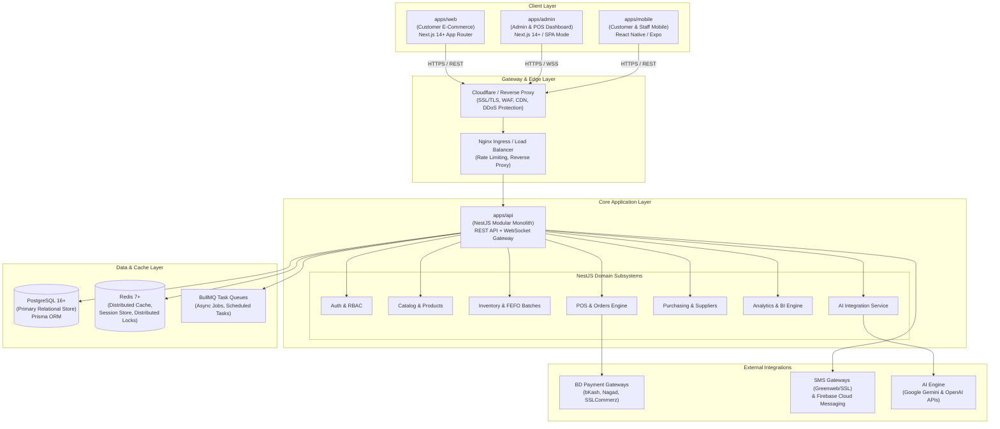
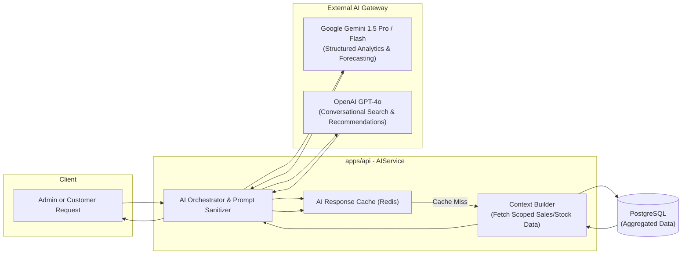

# ECOBAZAR — System Architecture Specification

## 1. Executive Summary

ECOBAZAR is an enterprise-grade, omnichannel retail operating system and intelligent supermarket management ecosystem tailored for the Bangladesh market (BDT ৳, Asia/Dhaka, English & Bangla). The platform bridges online e-commerce with physical multi-branch supermarket operations, including warehouse logistics, batch-level inventory tracking with First-Expired, First-Out (FEFO) allocation, Point of Sale (POS) checkout, automated purchasing, and AI-driven business intelligence.

This document defines the high-level system architecture, communication topologies, application responsibilities, and infrastructural boundaries.

---

## 2. High-Level System Architecture Diagram



---

## 3. Application Components & Responsibilities

### 3.1. Customer Website (`apps/web`)
- **Technology**: Next.js 14+ (App Router), React, TypeScript, Tailwind CSS, shadcn/ui, Framer Motion.
- **Rendering Strategy**:
  - **Server-Side Rendering (SSR)** & **Incremental Static Regeneration (ISR)** for high-SEO pages (Homepage, Category pages, Product detail pages, Brand showcases).
  - **Client-Side Rendering (CSR)** for dynamic user interactions (Shopping cart, checkout flow, user account, live order tracking).
- **Key Capabilities**:
  - Bilingual interface (English & Bangla with `Hind Siliguri` font support).
  - Geolocation detection to recommend the closest physical branch for express delivery.
  - Algolia/Meilisearch or Postgres Full-Text search with instant filtering.
  - Multi-step checkout optimized for mobile shoppers with bKash/Nagad direct pay and Cash on Delivery (COD).

### 3.2. Central Admin & POS Dashboard (`apps/admin`)
- **Technology**: Next.js 14+ (Client-heavy dashboard mode), React, TypeScript, Tailwind CSS, shadcn/ui, TanStack Table, Recharts.
- **Key Capabilities**:
  - **Super Admin & Owner View**: Organization-wide consolidated financial reports, branch comparisons, global catalog management, role assignment, audit log inspection.
  - **Branch Manager View**: Scoped to the assigned branch; manages local staff, local batch stock, goods receipts, register balancing, and local fulfillment.
  - **Point of Sale (POS) Interface**:
    - High-speed, keyboard-driven UI with dedicated shortcut keys (`F1`–`F12`).
    - Barcode scanner integration (USB/Bluetooth HID emulation).
    - Thermal receipt printing via browser print driver and ESC/POS network standards.
    - Cash drawer balancing, register opening/closing sessions, and variance tracking.
    - Local storage sync resilience for temporary network disconnects.

### 3.3. Cross-Platform Mobile Application (`apps/mobile`)
- **Technology**: React Native, Expo, TypeScript, NativeWind (Tailwind CSS for React Native), TanStack Query, Zustand.
- **Target Platforms**: Android (APK/AAB) and iOS (IPA).
- **Target Personas**:
  1. **Customer Mode**: Store browsing, cart, one-tap reordering, push notifications on order updates, loyalty barcode for in-store checkout.
  2. **Staff / Picker Mode**: Barcode scanning via camera for picking online orders and conducting physical inventory audits.
  3. **Delivery Rider Mode**: Delivery assignment, turn-by-turn navigation link, customer contact, OTP confirmation upon parcel handoff.

### 3.4. Backend Application (`apps/api`)
- **Technology**: Node.js 20+ LTS, NestJS 10+, TypeScript (Strict Mode), Prisma ORM.
- **Architecture**: Modular Monolith following Clean Architecture principles (Separation of Concerns, Dependency Injection, Domain DTOs, Repository/Service separation).
- **API Protocols**:
  - **REST API**: Structured JSON endpoints versioned under `/api/v1/`.
  - **WebSocket Gateway (Socket.io)**: Real-time channels for POS live order updates, rider location streaming, and stock alert broadcasts.
- **Data Protection**: Backend-enforced Row-Level Security and Branch Scoping Guards preventing any horizontal privilege escalation.

---

## 4. Communication & Networking Architecture

### 4.1. Client-to-Backend Protocol
Every client application communicates exclusively through the central NestJS API. Direct database access from frontend or mobile applications is strictly prohibited.

```
+-------------+         HTTPS / JSON          +------------------+
|  apps/web   | ----------------------------> |                  |
+-------------+                               |                  |
                                              |                  |
+-------------+    HTTPS / JSON + WebSocket   |     apps/api     |
| apps/admin  | ----------------------------> | (NestJS Gateway) |
+-------------+                               |                  |
                                              |                  |
+-------------+         HTTPS / JSON          |                  |
| apps/mobile | ----------------------------> |                  |
+-------------+                               +------------------+
```

### 4.2. API Gateway & Reverse Proxy
1. **Cloudflare / CDN Edge**: Handles edge SSL termination, DDOS mitigation, HTTP/3 transport, static asset caching (Next.js static assets, product images).
2. **Reverse Proxy (Nginx / Traefik)**:
   - Routes `/api/*` to `apps/api:4000`.
   - Routes admin dashboard traffic to `apps/admin:3001`.
   - Routes public web traffic to `apps/web:3000`.
   - Enforces IP whitelisting for sensitive admin endpoints and payment webhook callbacks.

---

## 5. Storage, Caching & Asynchronous Processing

### 5.1. PostgreSQL Relational Database
- **Role**: Single source of truth for all business entities, transactional ledgers, and financial records.
- **Connection Management**: PgBouncer connection pooling to handle high concurrent connections from serverless and multi-threaded worker instances.
- **Integrity Constraints**: Foreign keys, unique constraints, check constraints (e.g. `quantity >= 0`), and atomic interactive transactions (`prisma.$transaction`).

### 5.2. Redis Caching & Distributed Coordination
- **Distributed Cache**:
  - Product catalog and category hierarchies cached with TTL and event-driven invalidation.
  - Active user session tokens and token revocation blocklists.
- **Distributed Locks (`Redlock`)**:
  - Ensures concurrency safety during stock deduction and FEFO batch allocation during high-concurrency flash sales.
  - Prevents race conditions during purchase order receipt and cash register closing.
- **Rate Limiting**: Sliding window rate-limiting counter per IP and per authenticated user.

### 5.3. BullMQ Task Queuing & Scheduling
- **Queue Engine**: BullMQ on top of Redis.
- **Workers**:
  - `notification-queue`: Sends out transactional SMS, WhatsApp messages, emails, and push notifications without blocking HTTP requests.
  - `inventory-queue`: Nightly batch expiry calculations, alert triggers for goods nearing expiry within 30/60/90 days, and safety stock reorder point triggers.
  - `analytics-queue`: Hourly rollups of branch sales, gross profit calculations, and dead stock identification.
  - `report-queue`: Background generation of heavy PDF/Excel financial reports.

---

## 6. AI Subsystem Architecture



### 6.1. Architectural Principles for AI
1. **Zero Client-Side Credentials**: Frontends never communicate with OpenAI or Gemini directly. All requests pass through the NestJS `AIService`.
2. **Data Minimization & Privacy**: Personally Identifiable Information (PII) like customer names, phone numbers, and addresses is strictly redacted before generating prompts.
3. **Structured Outputs**: All LLM calls request strict JSON schemas (using function calling / structured outputs) to ensure safe parsing.
4. **Primary Use Cases**:
   - **Predictive Demand Forecasting**: Analyzing historic branch sales velocity to recommend automated purchase order quantities.
   - **Dynamic FEFO Clearance Assistant**: Identifying near-expiry batches and suggesting optimal bundle discounts to prevent spoilage.
   - **Bilingual Conversational Search**: Translating colloquial Bangla grocery queries into structured catalog filters (e.g. "পোলাও এর চাল" → Category: `Rice`, Subcategory: `Aromatic`).

---

## 7. External Integrations Architecture

### 7.1. Payment Gateways (Bangladesh Market)
- **bKash Tokenized Checkout**: Direct wallet debit, payment agreement for 1-click checkout, instant refund capability via API.
- **Nagad Payment Gateway**: Secure redirect and direct API integration with merchant signature verification.
- **SSLCommerz Aggregator**: Fallback multi-card payment processor for Visa, Mastercard, AMEX, and local internet banking.
- **Security & Idempotency**:
  - Inbound webhooks must be verified using HMAC-SHA256 signatures.
  - All payment callbacks require an `idempotency_key` stored in Redis/DB to prevent duplicate order generation.

### 7.2. Communications & Messaging
- **SMS Gateways**: Integrated with Bangladesh SMS providers (Greenweb, Elitbuzz, SSL Wireless) for OTP verification and order dispatch alerts.
- **Push Notifications**: Firebase Cloud Messaging (FCM) for mobile notifications to customers and delivery staff.
- **Transactional Emails**: Resend / SendGrid with localized HTML templates.
