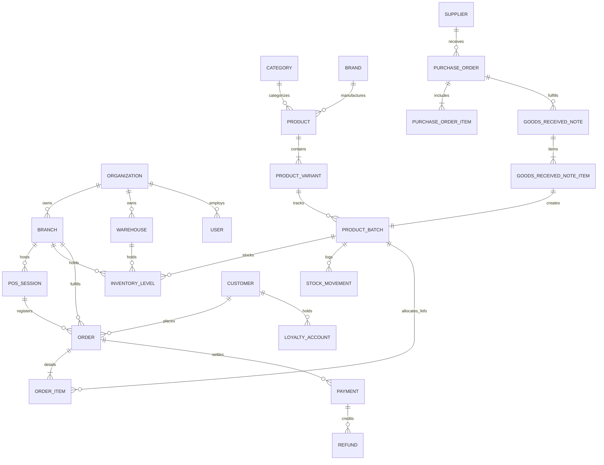

# ECOBAZAR — Relational Database Architecture Specification

## 1. Architectural Principles & Standards

The ECOBAZAR database is designed on **PostgreSQL 16+** using **Prisma ORM**. It adheres to the following strict conventions:
1. **Primary Keys**: Universally Unique Identifiers (UUID v4) generated via `gen_random_uuid()` to prevent ID enumeration and support distributed operations.
2. **Financial Precision**: All monetary values (cost, selling price, discounts, taxes, ledger balances) use `DECIMAL(12, 2)` or `DECIMAL(14, 4)` for high-precision unit cost calculations. IEEE Floating-point types are strictly forbidden.
3. **Quantity Precision**: Weight-based grocery items (e.g. 1.250 kg potatoes) require `DECIMAL(10, 3)`.
4. **Multi-Tenancy & Scoping**: Every business entity holds foreign keys to `organization_id` and, where applicable, `branch_id` or `warehouse_id`.
5. **Auditing & Timestamps**: Every table contains `created_at` and `updated_at` with time zone (`TIMESTAMPTZ`). Soft-deletable entities include `deleted_at`.
6. **Stock Integrity**: Database-level check constraints ensure non-negative inventory (`quantity >= 0`). Stock mutations require append-only historical ledgers (`stock_movements`).

---

## 2. Entity-Relationship Overview

---

## 3. Detailed Data Dictionary

### 3.1. Tenancy, Organization & Identity

#### `organizations`
- `id` (UUID, PK)
- `name` (VARCHAR(150), NOT NULL)
- `slug` (VARCHAR(100), UNIQUE, NOT NULL)
- `logo_url` (TEXT)
- `trade_license_number` (VARCHAR(100))
- `tax_identification_number` (VARCHAR(100))
- `default_currency` (VARCHAR(10), DEFAULT 'BDT')
- `default_timezone` (VARCHAR(50), DEFAULT 'Asia/Dhaka')
- `is_active` (BOOLEAN, DEFAULT TRUE)
- `created_at`, `updated_at` (TIMESTAMPTZ)

#### `branches`
- `id` (UUID, PK)
- `organization_id` (UUID, FK -> organizations.id, ON DELETE RESTRICT)
- `name` (VARCHAR(150), NOT NULL)
- `code` (VARCHAR(20), NOT NULL) — e.g. `ECO-DHK-01`
- `address_line1` (VARCHAR(255), NOT NULL)
- `address_line2` (VARCHAR(255))
- `city` (VARCHAR(100), NOT NULL)
- `division` (VARCHAR(100), NOT NULL) — Dhaka, Chittagong, etc.
- `postal_code` (VARCHAR(20))
- `latitude` (DECIMAL(10, 8))
- `longitude` (DECIMAL(11, 8))
- `phone` (VARCHAR(30), NOT NULL)
- `email` (VARCHAR(150))
- `is_main_branch` (BOOLEAN, DEFAULT FALSE)
- `is_active` (BOOLEAN, DEFAULT TRUE)
- `created_at`, `updated_at` (TIMESTAMPTZ)
- *Constraints*: `UNIQUE(organization_id, code)`

#### `warehouses`
- `id` (UUID, PK)
- `organization_id` (UUID, FK -> organizations.id, ON DELETE RESTRICT)
- `name` (VARCHAR(150), NOT NULL)
- `code` (VARCHAR(20), NOT NULL)
- `address` (TEXT, NOT NULL)
- `contact_person` (VARCHAR(100))
- `contact_phone` (VARCHAR(30))
- `total_capacity_sqft` (DECIMAL(10, 2))
- `is_active` (BOOLEAN, DEFAULT TRUE)
- `created_at`, `updated_at` (TIMESTAMPTZ)
- *Constraints*: `UNIQUE(organization_id, code)`

#### `users`
- `id` (UUID, PK)
- `organization_id` (UUID, FK -> organizations.id, ON DELETE RESTRICT)
- `branch_id` (UUID, NULLABLE, FK -> branches.id, ON DELETE SET NULL)
- `email` (VARCHAR(255), UNIQUE, NOT NULL)
- `phone` (VARCHAR(30), UNIQUE, NOT NULL)
- `password_hash` (VARCHAR(255), NOT NULL)
- `first_name` (VARCHAR(100), NOT NULL)
- `last_name` (VARCHAR(100), NOT NULL)
- `avatar_url` (TEXT)
- `is_active` (BOOLEAN, DEFAULT TRUE)
- `last_login_at` (TIMESTAMPTZ)
- `created_at`, `updated_at` (TIMESTAMPTZ)

#### `roles`
- `id` (UUID, PK)
- `organization_id` (UUID, FK -> organizations.id)
- `name` (VARCHAR(50), NOT NULL) — `SUPER_ADMIN`, `BRANCH_MANAGER`, `CASHIER`, `STAFF`
- `description` (TEXT)
- `is_system` (BOOLEAN, DEFAULT FALSE)
- `created_at`, `updated_at` (TIMESTAMPTZ)
- *Constraints*: `UNIQUE(organization_id, name)`

#### `permissions`
- `id` (UUID, PK)
- `code` (VARCHAR(100), UNIQUE, NOT NULL) — e.g. `inventory:fefo:override`, `pos:void_item`
- `name` (VARCHAR(150), NOT NULL)
- `category` (VARCHAR(50), NOT NULL)
- `created_at` (TIMESTAMPTZ)

#### `role_permissions`
- `role_id` (UUID, FK -> roles.id, ON DELETE CASCADE)
- `permission_id` (UUID, FK -> permissions.id, ON DELETE CASCADE)
- *Primary Key*: `(role_id, permission_id)`

#### `user_roles`
- `user_id` (UUID, FK -> users.id, ON DELETE CASCADE)
- `role_id` (UUID, FK -> roles.id, ON DELETE CASCADE)
- *Primary Key*: `(user_id, role_id)`

#### `sessions`
- `id` (UUID, PK)
- `user_id` (UUID, FK -> users.id, ON DELETE CASCADE)
- `refresh_token_hash` (VARCHAR(255), NOT NULL)
- `ip_address` (VARCHAR(45))
- `user_agent` (TEXT)
- `device_fingerprint` (VARCHAR(255))
- `is_revoked` (BOOLEAN, DEFAULT FALSE)
- `expires_at` (TIMESTAMPTZ, NOT NULL)
- `created_at`, `updated_at` (TIMESTAMPTZ)
- *Indexes*: `INDEX(user_id, is_revoked)`

---

### 3.2. Product Catalog & Taxonomy

#### `categories`
- `id` (UUID, PK)
- `organization_id` (UUID, FK -> organizations.id)
- `parent_id` (UUID, NULLABLE, FK -> categories.id)
- `name_en` (VARCHAR(150), NOT NULL)
- `name_bn` (VARCHAR(150), NOT NULL)
- `slug` (VARCHAR(150), NOT NULL)
- `image_url` (TEXT)
- `display_order` (INTEGER, DEFAULT 0)
- `is_active` (BOOLEAN, DEFAULT TRUE)
- `created_at`, `updated_at` (TIMESTAMPTZ)
- *Constraints*: `UNIQUE(organization_id, slug)`

#### `brands`
- `id` (UUID, PK)
- `organization_id` (UUID, FK -> organizations.id)
- `name_en` (VARCHAR(150), NOT NULL)
- `name_bn` (VARCHAR(150))
- `slug` (VARCHAR(150), NOT NULL)
- `logo_url` (TEXT)
- `is_active` (BOOLEAN, DEFAULT TRUE)
- `created_at`, `updated_at` (TIMESTAMPTZ)
- *Constraints*: `UNIQUE(organization_id, slug)`

#### `units_of_measurement`
- `id` (UUID, PK)
- `organization_id` (UUID, FK -> organizations.id)
- `name` (VARCHAR(50), NOT NULL) — e.g. "Kilogram", "Piece", "Liter"
- `code` (VARCHAR(10), NOT NULL) — "kg", "pc", "l"
- `is_fractional` (BOOLEAN, DEFAULT FALSE) — True for kg/litre, false for items like soaps

#### `products`
- `id` (UUID, PK)
- `organization_id` (UUID, FK -> organizations.id)
- `category_id` (UUID, FK -> categories.id)
- `brand_id` (UUID, NULLABLE, FK -> brands.id)
- `unit_id` (UUID, FK -> units_of_measurement.id)
- `name_en` (VARCHAR(255), NOT NULL)
- `name_bn` (VARCHAR(255), NOT NULL)
- `slug` (VARCHAR(255), NOT NULL)
- `description_en` (TEXT)
- `description_bn` (TEXT)
- `sku_base` (VARCHAR(100), NOT NULL)
- `vat_percentage` (DECIMAL(5, 2), DEFAULT 0.00)
- `is_perishable` (BOOLEAN, DEFAULT FALSE)
- `shelf_life_days` (INTEGER)
- `is_published` (BOOLEAN, DEFAULT TRUE)
- `created_at`, `updated_at` (TIMESTAMPTZ)
- *Constraints*: `UNIQUE(organization_id, sku_base)`

#### `product_variants`
- `id` (UUID, PK)
- `product_id` (UUID, FK -> products.id, ON DELETE CASCADE)
- `name_en` (VARCHAR(150), NOT NULL) — e.g. "1kg Pack", "500ml Bottle"
- `name_bn` (VARCHAR(150), NOT NULL)
- `sku` (VARCHAR(100), UNIQUE, NOT NULL)
- `primary_barcode` (VARCHAR(100), UNIQUE, NOT NULL)
- `weight_value` (DECIMAL(10, 3))
- `mrp` (DECIMAL(12, 2), NOT NULL) — Maximum Retail Price
- `default_selling_price` (DECIMAL(12, 2), NOT NULL)
- `created_at`, `updated_at` (TIMESTAMPTZ)

#### `product_barcodes`
- `id` (UUID, PK)
- `variant_id` (UUID, FK -> product_variants.id, ON DELETE CASCADE)
- `barcode` (VARCHAR(100), UNIQUE, NOT NULL)
- `barcode_type` (VARCHAR(30), DEFAULT 'EAN13') — EAN13, CODE128, QR
- `is_primary` (BOOLEAN, DEFAULT FALSE)

---

### 3.3. Batches, Expiry & Inventory Engine (FEFO)

#### `product_batches`
- `id` (UUID, PK)
- `organization_id` (UUID, FK -> organizations.id)
- `variant_id` (UUID, FK -> product_variants.id)
- `batch_number` (VARCHAR(100), NOT NULL)
- `manufacturing_date` (DATE)
- `expiry_date` (DATE, NOT NULL) — Foundation of FEFO allocation
- `cost_price` (DECIMAL(12, 2), NOT NULL) — Landed cost for profit calculations
- `selling_price` (DECIMAL(12, 2), NOT NULL)
- `initial_quantity` (DECIMAL(10, 3), NOT NULL)
- `status` (VARCHAR(30), DEFAULT 'ACTIVE') — `ACTIVE`, `NEAR_EXPIRY`, `EXPIRED`, `EXHAUSTED`, `QUARANTINED`
- `created_at`, `updated_at` (TIMESTAMPTZ)
- *Constraints*: `UNIQUE(variant_id, batch_number)`
- *Indexes*: `INDEX(expiry_date ASC, status)`, `INDEX(variant_id, status)`

#### `inventory_levels`
- `id` (UUID, PK)
- `organization_id` (UUID, FK -> organizations.id)
- `branch_id` (UUID, NULLABLE, FK -> branches.id)
- `warehouse_id` (UUID, NULLABLE, FK -> warehouses.id)
- `variant_id` (UUID, FK -> product_variants.id)
- `batch_id` (UUID, FK -> product_batches.id)
- `quantity_on_hand` (DECIMAL(10, 3), DEFAULT 0.000, NOT NULL)
- `quantity_reserved` (DECIMAL(10, 3), DEFAULT 0.000, NOT NULL)
- `quantity_available` (DECIMAL(10, 3), DEFAULT 0.000, NOT NULL)
- `reorder_point` (DECIMAL(10, 3), DEFAULT 10.000)
- `reorder_quantity` (DECIMAL(10, 3), DEFAULT 50.000)
- `bin_location` (VARCHAR(50)) — e.g. "Aisle 3, Shelf B, Bin 12"
- `updated_at` (TIMESTAMPTZ)
- *Constraints*: 
  - `CHECK(quantity_on_hand >= 0)`
  - `CHECK(quantity_available >= 0)`
  - `CHECK((branch_id IS NOT NULL AND warehouse_id IS NULL) OR (branch_id IS NULL AND warehouse_id IS NOT NULL))`
  - `UNIQUE(branch_id, warehouse_id, variant_id, batch_id)`

#### `stock_movements` (Immutable Audit Ledger)
- `id` (UUID, PK)
- `organization_id` (UUID, FK -> organizations.id)
- `branch_id` (UUID, NULLABLE, FK -> branches.id)
- `warehouse_id` (UUID, NULLABLE, FK -> warehouses.id)
- `variant_id` (UUID, FK -> product_variants.id)
- `batch_id` (UUID, FK -> product_batches.id)
- `user_id` (UUID, FK -> users.id)
- `movement_type` (VARCHAR(50), NOT NULL) — `PURCHASE_RECEIPT`, `POS_SALE`, `ONLINE_SALE`, `INTER_BRANCH_TRANSFER_OUT`, `INTER_BRANCH_TRANSFER_IN`, `CUSTOMER_RETURN`, `DAMAGE_WASTE`, `STOCK_AUDIT_ADJUSTMENT`
- `quantity` (DECIMAL(10, 3), NOT NULL) — Positive for inbound, negative for outbound
- `balance_before` (DECIMAL(10, 3), NOT NULL)
- `balance_after` (DECIMAL(10, 3), NOT NULL)
- `reference_id` (UUID) — Pointer to order_id, grn_id, transfer_id
- `reference_type` (VARCHAR(50))
- `note` (TEXT)
- `created_at` (TIMESTAMPTZ, NOT NULL)
- *Indexes*: `INDEX(variant_id, batch_id, created_at DESC)`, `INDEX(reference_id)`

#### `stock_transfers`
- `id` (UUID, PK)
- `organization_id` (UUID, FK -> organizations.id)
- `transfer_number` (VARCHAR(50), UNIQUE, NOT NULL) — e.g. `TRF-2026-0001`
- `source_branch_id` (UUID, NULLABLE, FK -> branches.id)
- `source_warehouse_id` (UUID, NULLABLE, FK -> warehouses.id)
- `destination_branch_id` (UUID, NULLABLE, FK -> branches.id)
- `destination_warehouse_id` (UUID, NULLABLE, FK -> warehouses.id)
- `status` (VARCHAR(30), DEFAULT 'DRAFT') — `DRAFT`, `DISPATCHED`, `IN_TRANSIT`, `RECEIVED`, `CANCELLED`
- `dispatched_by` (UUID, FK -> users.id)
- `received_by` (UUID, NULLABLE, FK -> users.id)
- `dispatched_at` (TIMESTAMPTZ)
- `received_at` (TIMESTAMPTZ)
- `created_at`, `updated_at` (TIMESTAMPTZ)

#### `stock_transfer_items`
- `id` (UUID, PK)
- `transfer_id` (UUID, FK -> stock_transfers.id, ON DELETE CASCADE)
- `variant_id` (UUID, FK -> product_variants.id)
- `batch_id` (UUID, FK -> product_batches.id)
- `quantity_requested` (DECIMAL(10, 3), NOT NULL)
- `quantity_shipped` (DECIMAL(10, 3), NOT NULL)
- `quantity_received` (DECIMAL(10, 3), DEFAULT 0.000)

---

### 3.4. Procurement & Suppliers

#### `suppliers`
- `id` (UUID, PK)
- `organization_id` (UUID, FK -> organizations.id)
- `name` (VARCHAR(200), NOT NULL)
- `contact_person` (VARCHAR(100))
- `phone` (VARCHAR(30), NOT NULL)
- `email` (VARCHAR(150))
- `trade_license` (VARCHAR(100))
- `bank_name` (VARCHAR(150))
- `bank_account_number` (VARCHAR(100))
- `bank_routing_number` (VARCHAR(50))
- `payment_terms_days` (INTEGER, DEFAULT 30)
- `is_active` (BOOLEAN, DEFAULT TRUE)
- `created_at`, `updated_at` (TIMESTAMPTZ)

#### `purchase_orders`
- `id` (UUID, PK)
- `organization_id` (UUID, FK -> organizations.id)
- `branch_id` (UUID, NULLABLE, FK -> branches.id)
- `warehouse_id` (UUID, NULLABLE, FK -> warehouses.id)
- `supplier_id` (UUID, FK -> suppliers.id)
- `po_number` (VARCHAR(50), UNIQUE, NOT NULL)
- `status` (VARCHAR(30), DEFAULT 'DRAFT') — `DRAFT`, `SUBMITTED`, `APPROVED`, `PARTIALLY_RECEIVED`, `COMPLETED`, `CANCELLED`
- `expected_delivery_date` (DATE)
- `subtotal_amount` (DECIMAL(12, 2), NOT NULL)
- `tax_amount` (DECIMAL(12, 2), DEFAULT 0.00)
- `total_amount` (DECIMAL(12, 2), NOT NULL)
- `created_by` (UUID, FK -> users.id)
- `approved_by` (UUID, NULLABLE, FK -> users.id)
- `created_at`, `updated_at` (TIMESTAMPTZ)

#### `purchase_order_items`
- `id` (UUID, PK)
- `purchase_order_id` (UUID, FK -> purchase_orders.id, ON DELETE CASCADE)
- `variant_id` (UUID, FK -> product_variants.id)
- `quantity_ordered` (DECIMAL(10, 3), NOT NULL)
- `unit_cost_price` (DECIMAL(12, 2), NOT NULL)
- `total_cost` (DECIMAL(12, 2), NOT NULL)

#### `goods_received_notes` (GRN)
- `id` (UUID, PK)
- `organization_id` (UUID, FK -> organizations.id)
- `purchase_order_id` (UUID, FK -> purchase_orders.id)
- `grn_number` (VARCHAR(50), UNIQUE, NOT NULL)
- `received_by` (UUID, FK -> users.id)
- `received_at` (TIMESTAMPTZ, NOT NULL)
- `invoice_number` (VARCHAR(100))
- `total_landed_cost` (DECIMAL(12, 2), NOT NULL)
- `remarks` (TEXT)
- `created_at` (TIMESTAMPTZ)

#### `goods_received_note_items`
- `id` (UUID, PK)
- `grn_id` (UUID, FK -> goods_received_notes.id, ON DELETE CASCADE)
- `variant_id` (UUID, FK -> product_variants.id)
- `batch_id` (UUID, FK -> product_batches.id) — Links directly to the newly created batch!
- `quantity_received` (DECIMAL(10, 3), NOT NULL)
- `quantity_rejected` (DECIMAL(10, 3), DEFAULT 0.000)
- `unit_cost` (DECIMAL(12, 2), NOT NULL)

---

### 3.5. Customers & Loyalty

#### `customers`
- `id` (UUID, PK)
- `organization_id` (UUID, FK -> organizations.id)
- `phone` (VARCHAR(30), NOT NULL)
- `email` (VARCHAR(255))
- `first_name` (VARCHAR(100), NOT NULL)
- `last_name` (VARCHAR(100))
- `is_verified` (BOOLEAN, DEFAULT FALSE)
- `loyalty_card_barcode` (VARCHAR(100), UNIQUE)
- `created_at`, `updated_at` (TIMESTAMPTZ)
- *Constraints*: `UNIQUE(organization_id, phone)`

#### `customer_addresses`
- `id` (UUID, PK)
- `customer_id` (UUID, FK -> customers.id, ON DELETE CASCADE)
- `address_label` (VARCHAR(50)) — "Home", "Office"
- `contact_person` (VARCHAR(100))
- `contact_phone` (VARCHAR(30))
- `address_line` (TEXT, NOT NULL)
- `area` (VARCHAR(100), NOT NULL) — e.g. "Gulshan-2", "Dhanmondi"
- `city` (VARCHAR(100), NOT NULL)
- `latitude` (DECIMAL(10, 8))
- `longitude` (DECIMAL(11, 8))
- `is_default` (BOOLEAN, DEFAULT FALSE)

#### `loyalty_accounts`
- `id` (UUID, PK)
- `customer_id` (UUID, UNIQUE, FK -> customers.id)
- `current_points` (INTEGER, DEFAULT 0, NOT NULL)
- `lifetime_points` (INTEGER, DEFAULT 0, NOT NULL)
- `tier_level` (VARCHAR(30), DEFAULT 'SILVER') — `SILVER`, `GOLD`, `PLATINUM`
- `updated_at` (TIMESTAMPTZ)

#### `loyalty_transactions`
- `id` (UUID, PK)
- `loyalty_account_id` (UUID, FK -> loyalty_accounts.id)
- `order_id` (UUID, NULLABLE)
- `points` (INTEGER, NOT NULL) — Positive for earned, negative for redeemed
- `transaction_type` (VARCHAR(50), NOT NULL) — `PURCHASE_EARN`, `ORDER_REDEMPTION`, `MANUAL_ADJUSTMENT`, `BONUS`
- `created_at` (TIMESTAMPTZ)

---

### 3.6. Orders, POS & Sales Engine

#### `pos_sessions`
- `id` (UUID, PK)
- `branch_id` (UUID, FK -> branches.id)
- `cashier_id` (UUID, FK -> users.id)
- `session_number` (VARCHAR(50), UNIQUE, NOT NULL)
- `opening_time` (TIMESTAMPTZ, NOT NULL)
- `closing_time` (TIMESTAMPTZ)
- `opening_float` (DECIMAL(12, 2), NOT NULL)
- `expected_cash_drawer` (DECIMAL(12, 2))
- `actual_counted_cash` (DECIMAL(12, 2))
- `cash_difference` (DECIMAL(12, 2))
- `status` (VARCHAR(30), DEFAULT 'OPEN') — `OPEN`, `CLOSED`, `RECONCILED`
- `notes` (TEXT)

#### `orders`
- `id` (UUID, PK)
- `organization_id` (UUID, FK -> organizations.id)
- `branch_id` (UUID, FK -> branches.id)
- `customer_id` (UUID, NULLABLE, FK -> customers.id)
- `pos_session_id` (UUID, NULLABLE, FK -> pos_sessions.id)
- `order_number` (VARCHAR(50), UNIQUE, NOT NULL) — e.g. `ECO-ORD-20261116-0001`
- `order_channel` (VARCHAR(30), NOT NULL) — `POS_STORE`, `ONLINE_WEB`, `ONLINE_APP`
- `status` (VARCHAR(30), DEFAULT 'PENDING') — `PENDING`, `CONFIRMED`, `PROCESSING`, `READY_FOR_PICKUP`, `OUT_FOR_DELIVERY`, `DELIVERED`, `CANCELLED`, `RETURNED`
- `payment_status` (VARCHAR(30), DEFAULT 'UNPAID') — `UNPAID`, `PARTIALLY_PAID`, `PAID`, `REFUNDED`
- `subtotal_amount` (DECIMAL(12, 2), NOT NULL)
- `discount_amount` (DECIMAL(12, 2), DEFAULT 0.00)
- `vat_amount` (DECIMAL(12, 2), DEFAULT 0.00)
- `delivery_fee` (DECIMAL(12, 2), DEFAULT 0.00)
- `total_payable` (DECIMAL(12, 2), NOT NULL)
- `delivery_address_id` (UUID, NULLABLE, FK -> customer_addresses.id)
- `rider_id` (UUID, NULLABLE, FK -> users.id)
- `notes` (TEXT)
- `created_at`, `updated_at` (TIMESTAMPTZ)
- *Indexes*: `INDEX(branch_id, status)`, `INDEX(customer_id)`, `INDEX(created_at DESC)`

#### `order_items`
- `id` (UUID, PK)
- `order_id` (UUID, FK -> orders.id, ON DELETE CASCADE)
- `variant_id` (UUID, FK -> product_variants.id)
- `batch_id` (UUID, FK -> product_batches.id) — Critical: FEFO batch link!
- `quantity` (DECIMAL(10, 3), NOT NULL)
- `unit_price` (DECIMAL(12, 2), NOT NULL)
- `unit_cost` (DECIMAL(12, 2), NOT NULL) — Recorded at sale time for accurate margin reporting
- `discount_amount` (DECIMAL(12, 2), DEFAULT 0.00)
- `vat_amount` (DECIMAL(12, 2), DEFAULT 0.00)
- `total_price` (DECIMAL(12, 2), NOT NULL)

---

### 3.7. Payments & Financial Transactions

#### `payments`
- `id` (UUID, PK)
- `organization_id` (UUID, FK -> organizations.id)
- `order_id` (UUID, FK -> orders.id)
- `payment_number` (VARCHAR(50), UNIQUE, NOT NULL)
- `amount` (DECIMAL(12, 2), NOT NULL)
- `method` (VARCHAR(30), NOT NULL) — `CASH`, `BKASH`, `NAGAD`, `CARD`, `LOYALTY_POINTS`, `GIFT_VOUCHER`
- `status` (VARCHAR(30), DEFAULT 'PENDING') — `PENDING`, `SUCCESS`, `FAILED`, `CANCELLED`
- `gateway_transaction_id` (VARCHAR(150))
- `gateway_response_payload` (JSONB)
- `idempotency_key` (VARCHAR(100), UNIQUE)
- `processed_by` (UUID, NULLABLE, FK -> users.id) — Null if automated online payment
- `paid_at` (TIMESTAMPTZ)
- `created_at` (TIMESTAMPTZ)

#### `refunds`
- `id` (UUID, PK)
- `payment_id` (UUID, FK -> payments.id)
- `order_id` (UUID, FK -> orders.id)
- `refund_number` (VARCHAR(50), UNIQUE, NOT NULL)
- `amount` (DECIMAL(12, 2), NOT NULL)
- `reason` (TEXT, NOT NULL)
- `status` (VARCHAR(30), DEFAULT 'COMPLETED')
- `approved_by` (UUID, FK -> users.id)
- `created_at` (TIMESTAMPTZ)

---

### 3.8. Marketing, Coupons & Campaigns

#### `coupons`
- `id` (UUID, PK)
- `organization_id` (UUID, FK -> organizations.id)
- `code` (VARCHAR(50), NOT NULL)
- `discount_type` (VARCHAR(20), NOT NULL) — `PERCENTAGE`, `FIXED_AMOUNT`
- `discount_value` (DECIMAL(10, 2), NOT NULL)
- `min_order_amount` (DECIMAL(12, 2), DEFAULT 0.00)
- `max_discount_amount` (DECIMAL(12, 2))
- `usage_limit_total` (INTEGER)
- `usage_limit_per_customer` (INTEGER, DEFAULT 1)
- `total_used_count` (INTEGER, DEFAULT 0)
- `start_date` (TIMESTAMPTZ, NOT NULL)
- `end_date` (TIMESTAMPTZ, NOT NULL)
- `is_active` (BOOLEAN, DEFAULT TRUE)
- *Constraints*: `UNIQUE(organization_id, code)`

---

### 3.9. Auditing & System Logs

#### `audit_logs`
- `id` (UUID, PK)
- `organization_id` (UUID, FK -> organizations.id)
- `branch_id` (UUID, NULLABLE)
- `user_id` (UUID, NULLABLE)
- `action` (VARCHAR(100), NOT NULL)
- `resource_type` (VARCHAR(100), NOT NULL)
- `resource_id` (VARCHAR(100), NOT NULL)
- `before_state` (JSONB)
- `after_state` (JSONB)
- `ip_address` (VARCHAR(45))
- `user_agent` (TEXT)
- `created_at` (TIMESTAMPTZ, DEFAULT NOW(), NOT NULL)
- *Indexes*: `INDEX(resource_type, resource_id)`, `INDEX(user_id)`, `INDEX(created_at DESC)`
